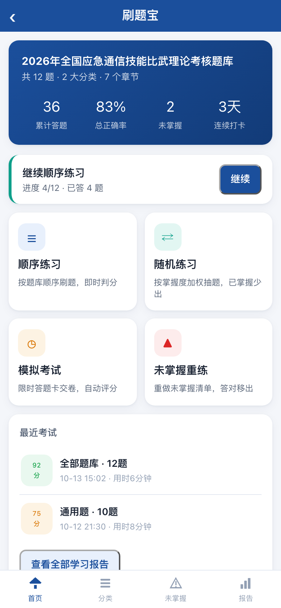
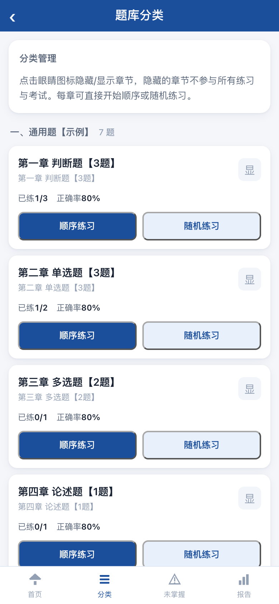
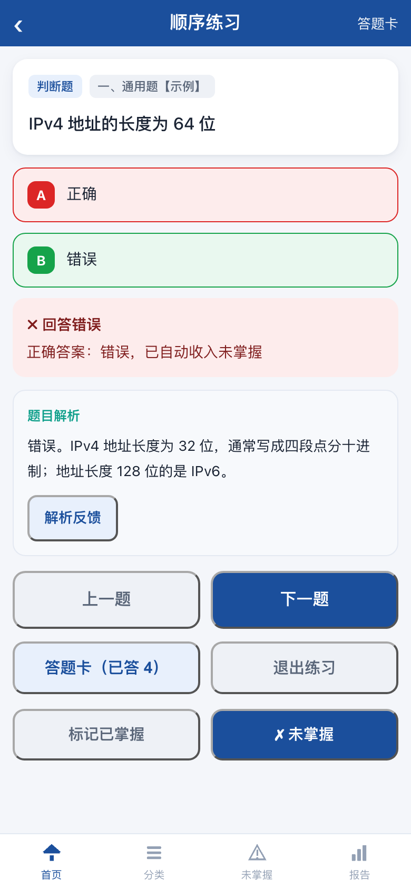
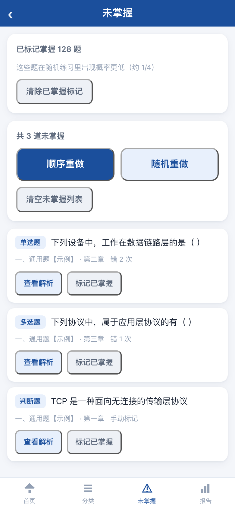
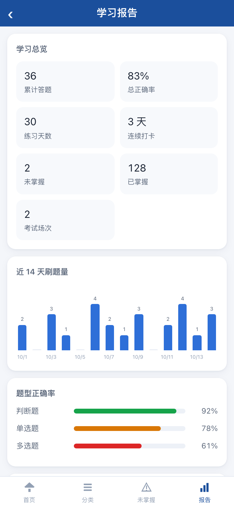
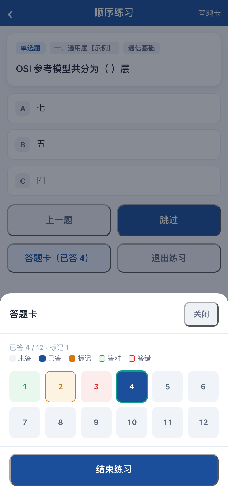

# 刷题宝 · 题库练习小程序

把题库文档（**PDF / Word / 文本**）变成可以直接发布的**微信小程序**刷题应用 —— 全程在 WorkBuddy 里完成，不用写代码、不用装环境。

功能：顺序 / 随机练习、模拟考试、未掌握清单、已掌握降权、答题卡、学习报告、主观题自评、题目解析、解析反馈（云端汇总）。

> **本仓库不含真实题库与解析**，只带 12 道示例题（覆盖全部 7 种题型）用于跑通流程。

## 界面

| 首页 | 题库分类 | 练习（答错即时反馈 + 掌握度标记 + 解析） |
| --- | --- | --- |
|  |  |  |
| **未掌握** | **学习报告** | **答题卡** |
|  |  |  |

---

## 掌握度与抽题

练习模式答完一题后，页面最底部（「答题卡」那一行的下面）给两个按钮：**标记已掌握** / **标记未掌握**。它们决定这道题以后多久再遇到你。

| 状态 | 怎么进 | 之后的表现 |
| --- | --- | --- |
| **未掌握** | 答错自动入库；或手动点「标记未掌握」 | 随机练习抽题权重 **×4**（最容易再遇到）；出现在「未掌握」页 |
| 普通 | 默认 | 权重 **×2** |
| **已掌握** | 手动点「标记已掌握」；或在「未掌握」页点「标记已掌握」 | 权重 **×1**（出现概率约为普通的 1/2、未掌握的 1/4） |

- **随机练习**按上面的权重加权抽题；**模拟考试不加权**（保持公平抽样，成绩才有可比性）；顺序练习按题库原序，不涉及概率。
- 主观题自评的「已掌握 / 未掌握」按钮与客观题是同一套状态。
- 已掌握标记可整体清除：报告页或「未掌握」页的「清除已掌握标记」。

---

## 快速开始（推荐）

**三步，不用敲命令、不用装 Python —— 让 WorkBuddy 干。**

### 1. 安装技能

把技能地址发给 WorkBuddy 让它安装：

**https://github.com/xprears/shuati-miniprogram/blob/main/skills/SKILL.md**

> 手动安装也一样简单：把仓库里的 `skills/SKILL.md` 复制到 `~/.workbuddy/skills/shuati-bao/` 即可。

### 2. 把题库文件交给 WorkBuddy

打开 WorkBuddy，说一句：

> 用刷题宝把这个题库做成小程序

然后把 PDF / Word / 文本拖进对话，或直接粘贴内容。

### 3. 扫码试用并发布

WorkBuddy 会自己完成：拉代码 → 文档转标准题库 JSON（+ 解析 JSON）→ 生成小程序 → 拉起预览。
点开预览卡片扫码，就能在真机上刷题。满意后点预览面板右上角 **「分享 / Share」→ 发布**。

---

## 技能做了什么

技能说明写在 [skills/SKILL.md](skills/SKILL.md)，你不用手敲，但知道流程便于排错：

```
你的文档（PDF / Word / 文本）
   │  ① 按提示词 A 转成 build/questions.json
   │  ② 有答案要点时按提示词 B 生成 build/explanations/ch1_analysis.json
   ▼
③ node build/build_bank.js   →  miniprogram/utils/qbank.js（小程序题库）
④ node build/mp-lint.js      →  静态校验（文件齐全 / 事件 / 体积）
⑤ WorkBuddy 拉起 miniprogram/ 预览 → 扫码 → 发布
```

`build_bank.js` 与 `mp-lint.js` 都是**零依赖 Node 脚本**（WorkBuddy 自带 Node），会校验 id 重复、题型非法、选项键断号、答案越界，并报告解析覆盖了多少题。

### 想自己敲命令行

只在你想手动控制时用得上：

```bash
git clone --depth 1 https://github.com/xprears/shuati-miniprogram.git
cd shuati-miniprogram
node build/build_bank.js --sample    # 先用示例题库看效果
node build/build_bank.js             # 用自己的 build/questions.json
node build/mp-lint.js                # 校验
```

---

## 题库格式

AI 会按下面的格式产出 `build/questions.json`（一个**数组**，每个元素一道题）。想手改也照这个来：

```json
[
  {
    "id": "q0001",
    "type": "single",
    "stem": "下列设备中，工作在数据链路层的是（ ）",
    "options": [
      { "key": "A", "text": "交换机" },
      { "key": "B", "text": "路由器" },
      { "key": "C", "text": "中继器" },
      { "key": "D", "text": "集线器" }
    ],
    "answer": "A",
    "part": "一、通用题【各单位】",
    "chapter": "第二章 单选题【3题】",
    "category": "通信基础",
    "qno": 1
  }
]
```

| 字段 | 必填 | 说明 |
| --- | --- | --- |
| `id` | ✓ | 全局唯一，如 `q0001`。解析文件靠它对应 |
| `type` | ✓ | `judge` 判断 / `single` 单选 / `multi` 多选 / `essay` 论述 / `scenario` 情景判断 / `case` 案例分析 / `operation` 实操模拟 |
| `stem` | ✓ | 题干。**空位统一写全角「（ ）」**（U+FF08 + 空格 + U+FF09） |
| `options` | 客观题 | `[{"key":"A","text":"…"}]`，键必须从 A 起连续；**选项数不固定**（3 项、5 项都支持） |
| `answer` | 客观题 | 判断题用 `√` / `×`；单选题一个字母；多选题 2 个以上字母（如 `ACD`） |
| `reference` | 主观题 | 参考要点原文，编号建议 `(1)(2)(3)` |
| `part` | ✓ | 大部，如 `一、通用题【各单位】`、`二、专业题【无线】` |
| `chapter` | ✓ | 章节，如 `第七章 单选题【120题】` |
| `category` | ✗ | 分类标签，可为 `null` |
| `qno` | ✗ | 原文题号（便于对照纸质卷） |
| `analysis` | ✗ | 题目解析，由解析文件注入，不必手写 |

构建产物 `miniprogram/utils/qbank.js` 的字段被压缩：`i`=id `t`=类型 `s`=题干 `p`=大部 `c`=章节 `g`=分类 `o`=选项 `a`=答案 `r`=参考答案 `x`=解析。
**它是产物，不要手改**（下次构建即被覆盖），也已被 `.gitignore` 排除。

### 自定义

- 题型标签、题池规则：`miniprogram/utils/logic.js`（`TYPE_LABEL` / `TYPE_ORDER` / `poolIds`）
- 配色与标题：`miniprogram/app.wxss`、`miniprogram/app.json`（`navigationBarTitleText` 与 `tabBar`）

#### 命名口径（改动前先看这里）

「刷题宝」是**产品名**，「××题库」是**内容名**，两者分工固定，不要混用：

| 位置 | 写什么 | 改哪里 |
| --- | --- | --- |
| 导航栏标题 | 产品名（刷题宝） | `app.json` 的 `navigationBarTitleText`、`pages/index/index.json` |
| 分享文案 | 产品名（刷题宝） | 各页 `onShareAppMessage` 的 `title` |
| 首页 hero 大标题 | **题库名**（题库全称，如「2026年全国应急通信技能比武理论考核题库」） | `pages/index/index.wxml` 的 `.hero-title` |
| 题库内容本身 | 题库名 | `build/questions.json`、PDF 原件 |

> 题库名只有一个出处：题库原件（PDF/Word）的标题。改 hero 时以原件为准，不要从产品名反推。
> hero 标题是长全称，`app.wxss` 里 `.hero .hero-title` 的字号按「单行放得下」调过（15px），换更长的题库名要重新核一下宽度。

---

## 题目解析

解析单独存放，一个 id 对应一条讲解：

```
build/explanations/ch1_analysis.json   # 第一章
build/explanations/ch2_analysis.json   # 第二章
...
```

格式就是「题号 → 解析文本」的映射：

```json
{
  "q0001": "交换机工作在数据链路层。它依据 MAC 地址转发数据帧；路由器依据 IP 地址工作在网络层；中继器与集线器工作在物理层，只做信号再生与广播。"
}
```

文件名必须是 `ch<数字>_analysis.json`。解析注入后 App 里出现在：练习模式的答题反馈区、主观题「查看参考答案」区、自评页、未掌握页「查看解析」弹层。
**考试模式与「关闭即时反馈」时不显示解析**，避免泄题。

### 写作要求（直接影响 App 里的可读性）

- **客观题**：首句直接给结论，并把正确选项的核心文本并列写出来；干扰项只放在第一个句号之后。不要用「A 为…」这种字母开头。
- **判断题**：固定以「正确。」或「错误。」开头，再说理由。
- **多选题**：首句并列所有正确项；全对的题写明「本题各项均正确，无干扰项」。
- **主观题**：≥120 字，覆盖参考答案里的每个要点编号，不能只复述题干。
- **不要编造**：题干和选项之外的事实性宣称（数值、倍率、标准号）必须可追溯；追溯不到就写成「按本题库答案」的中性表述。
- **题库答案与常识冲突时**：以题库答案为准，在解析末尾用括号注明严格的学科定义，**不要**替题库编一套自相矛盾的机理。

---

## 提示词

想自己跟 AI 对话生成题库与解析，直接用现成提示词：

📄 **[docs/ai-bank-prompt.md](docs/ai-bank-prompt.md)** —— 提示词 A（文档 → 题库 JSON）、提示词 B（题库 → 解析 JSON），含字段规范、空位还原规则与「输入片段 → 正确输出」示例。

---

## 部署到微信小程序（通过 WorkBuddy）

小程序代码就在 `miniprogram/`，两种方式任选。

### 方式 A：WorkBuddy 预览 + 发布（推荐，不用装开发者工具）

1. 在 WorkBuddy 里打开本项目目录，说「**预览小程序**」——它会识别 `miniprogram/` 并生成**小程序产物卡片**。
2. 点开卡片进入预览，用微信扫码即可在真机上试。
3. 预览面板右上角 **「分享 / Share」→ 发布**：
   - 选「**试用小程序**」：几分钟出一个可长期使用的体验版，够内部小范围使用；
   - 或「**绑定已有小程序**」：填自己的 AppID，发到自己的正式小程序。
4. 发布时**保持同一个应用 ID**（若你开通过云服务，换 ID 会导致云服务校验失败）。

> ⚠️ 小程序**不要**用 `sites` 类的一键部署（部署预检会拒绝小程序目录），走上面的产物卡片即可。

### 方式 B：微信开发者工具

用微信开发者工具「导入项目」，目录选 `miniprogram/`；把 `project.config.json` 里的 `appid` 换成你自己的 AppID（不换则用测试号，只能本机预览）。

### 解析反馈（可选）

`miniprogram/pkg-feedback/` 会把「解析有问题」的反馈汇总到云端，题主在首页长按标题进入汇总页。启用步骤：

1. 在 WorkBuddy 里为本项目开通云服务，建一张表（字段见 `pkg-feedback/lib/cloud.js` 里的 `row`：`question_id / qno / chapter / part / qtype / stem / kind / content / client_tag / created_at`）。
2. 行级权限：给 `anon`、`authenticated` 开 **SELECT** 与 **INSERT** 即可（刻意不开 UPDATE / DELETE —— 小程序端删不掉数据，客户端反编译也没有破坏风险；清理由题主在后台按需删除）。
3. 复制 `miniprogram/pkg-feedback/lib/config.example.js` 为 `config.js`，填入激活返回的 `endpoint` 与 `publishableKey`：

```js
module.exports = {
  endpoint: 'https://mp-api.app.workbuddy.host',
  publishableKey: 'wbpk_你的appId_xxxxxxxx',
  table: 'question_feedback'
};
```

`config.js` 已被 `.gitignore` 排除（属于你自己的凭据，不要提交）。**不配也能跑**：反馈入口会提示「云服务未配置」，刷题、未掌握清单、报告等功能完全不受影响。

---

## 目录结构

```
.
├─ miniprogram/                    微信小程序
│  ├─ app.js / app.json / app.wxss
│  ├─ pages/                       首页 · 分类 · 未掌握 · 报告 · 设置 · 练习 · 结果
│  ├─ utils/logic.js               纯逻辑：评分 / 题池 / 结构树（无 wx 依赖，可 Node 单测）
│  ├─ utils/store.js               本地进度、未掌握清单与已掌握标记存储
│  ├─ utils/qbank.js               ← 构建产物（不入库，由技能生成）
│  └─ pkg-feedback/                解析反馈分包（提交表单 + 汇总列表 + 云 SDK）
├─ build/
│  ├─ build_bank.js            ★   构建：questions.json → miniprogram/utils/qbank.js（零依赖）
│  ├─ mp-lint.js                   小程序静态校验（体积 / 事件 / API 白名单）
│  └─ sample/                      示例题库 + 示例解析
├─ docs/
│  ├─ ai-bank-prompt.md            AI 生成题库 / 解析的提示词
│  └─ screenshots/                 界面截图
└─ skills/SKILL.md                 WorkBuddy 技能（导入即用，见「快速开始」）
```

---

## 常见问题

**为什么仓库里没有 `miniprogram/utils/qbank.js`？**
它是构建产物，内容就是你的题库。`.gitignore` 已排除，避免把题库误传上 GitHub。跑一次 `node build/build_bank.js --sample`（或让技能生成）就有了。

**必须装 Python 吗？**
不用。仓库里只有零依赖 Node 脚本 —— WorkBuddy 自带 Node。

**主包会不会超 2MB？**
微信小程序主包上限 2MB。题库 + 解析全部编译进 `miniprogram/utils/qbank.js`，题目多、解析长时容易逼近上限（数千题 + 全量解析可接近 1.7MB）。接近上限时把 `qbank.js` 挪进分包，或让解析按需从云端拉。`node build/mp-lint.js` 会直接报主包与各分包体积。

**改了题库怎么生效？**
改 `build/questions.json` 后重跑 `node build/build_bank.js`；小程序端在开发者工具里刷新即可看到。

**解析没显示？**
检查解析文件的键是否等于题库里的 `id`，以及构建时「解析：命中 N/M 题」的输出。考试模式和「关闭即时反馈」不显示解析，这是刻意设计。

**能换成别的内容吗？**
可以。这套东西本质是「题库 JSON → 刷题小程序」，把 `type`/`part`/`chapter` 换成你的学科结构即可；`miniprogram/utils/logic.js` 里改题型标签就能适配。

---

## 许可

示例代码可自由使用、修改、分发。**题库与解析内容不在本仓库内**，版权与使用范围请自行确认。需要正式开源许可可自行添加 `LICENSE`。
