# 刷题本子 · 刷题练习工具

把题库文档（**PDF / Word / 文本**）变成可以直接发布的**微信小程序**刷题练习工具 —— 全程在 WorkBuddy 里完成，不用写代码、不用装环境。

功能：顺序 / 随机练习、模拟测验、未掌握清单、已掌握降权、答题卡、练习报告、主观题自评、题目解析。

> **零后端**：题库、答题记录、掌握度数据全部存储在用户手机本地（`wx.storage`），不连接任何服务器、不需要账号。

**两种发布形态**（默认前者）：

| 形态 | 说明 |
| --- | --- |
| **空壳发布（默认）** | 小程序**不含任何题库**，终端用户在 App 内「导入题库」页自行上传（粘贴 JSON / 从微信聊天选文件）。适合做通用刷题工具上架 |
| 预置题库（可选） | 用 `build/build_bank.js` 把你的题库编译进 `miniprogram/utils/qbank.js`，用户开箱即刷。适合给固定人群交付 |

> **本仓库不含真实题库与解析**，只带 14 道示例题（覆盖全部 8 种题型，含填空题）用于开发与测试。

## 用户自行导入题库（空壳发布形态）

发布物里没有任何题库，用户第一次打开会看到空态引导，三步即可开刷：

1. **获取题库 JSON** —— 导入页内置「复制转换指令」按钮（一句话 + 仓库链接，AI 自己打开规范照着转）；AI 打不开链接时再用「复制完整提示词」兜底。复制后发给任意 AI（元宝 / DeepSeek / 豆包等），附上题库文档，AI 会返回标准 JSON。也可以直接粘贴已有的 JSON 文件内容（支持提示词 A 的详细态，也支持 `qbank.js` 的紧凑态）。
2. **粘贴或选文件** —— 粘贴到文本框点「校验并导入」；大题库（2000 题以上）建议先把 JSON 文件发到微信任意聊天，从小程序卡片进入后再「从聊天记录选文件」。
3. **启用题库** —— 实时校验（id 重复、题型非法、选项键断号、答案越界都会按题号列出），通过后点「启用题库」，回首页即可练习。

- 题库按 700KB 分片存本地（`wx.storage` 单 key 上限 1MB），总量上限 9MB（约 1.2 万题带解析）。
- 导入页支持**导出到剪贴板**（备份 / 换机）与**清除题库**；换库后答题记录按题号匹配，匹配不上的不再显示。
- 「从聊天记录选文件」需在小程序后台**用户隐私保护指引**里声明「从聊天会话中选择文件」，发布时一并勾选。
- 细节与取舍见 [`docs/用户题库导入方案.md`](docs/用户题库导入方案.md)。

## 界面

> 截图由 `build/shots/collect.js`（跑真实页面逻辑取 data）+ `render.js`（WXML → HTML，套真实 `app.wxss`）生成，数据为示例题库 14 题 + 一份练习记录，非手绘。

| 首页（未导入题库） | 首页（已导入） | 导入题库 |
| --- | --- | --- |
| 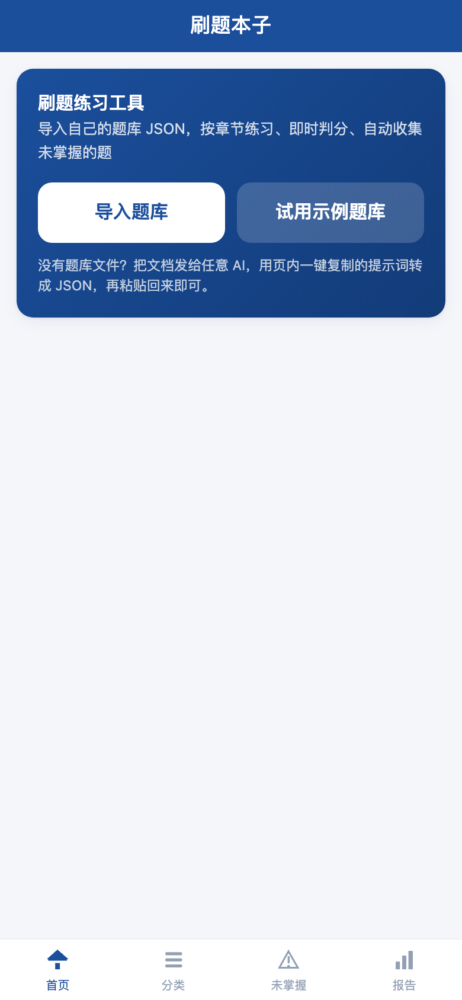 | 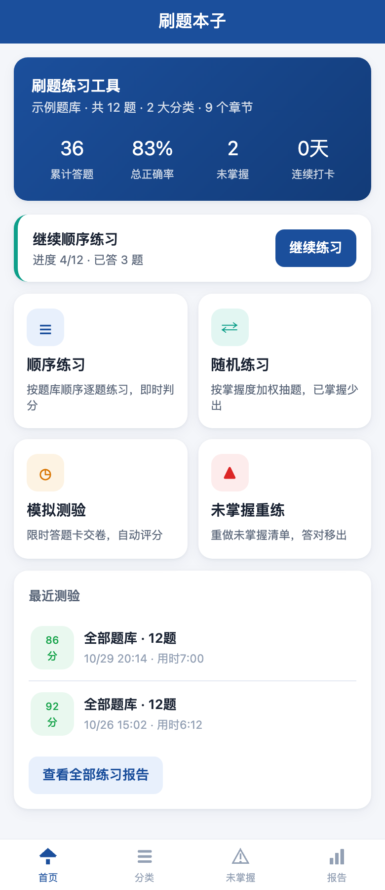 | 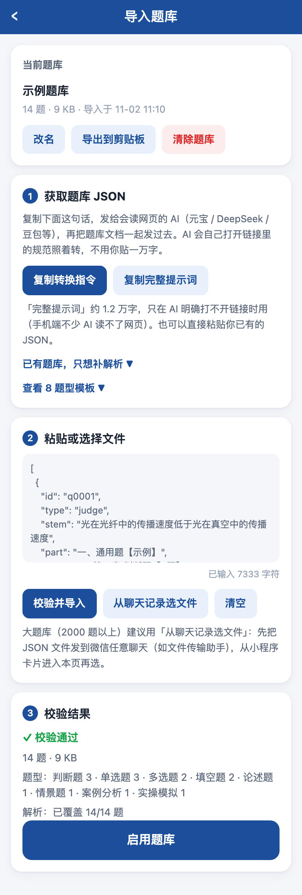 |
| **分类管理** | **练习设置** | **答题（即时判分 + 解析）** |
| 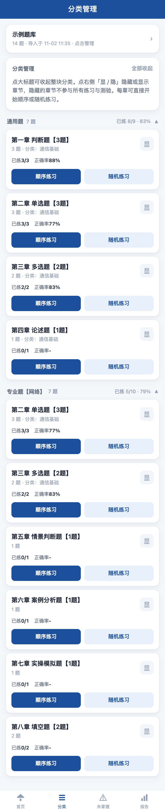 | 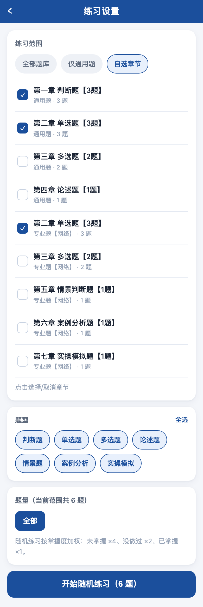 | 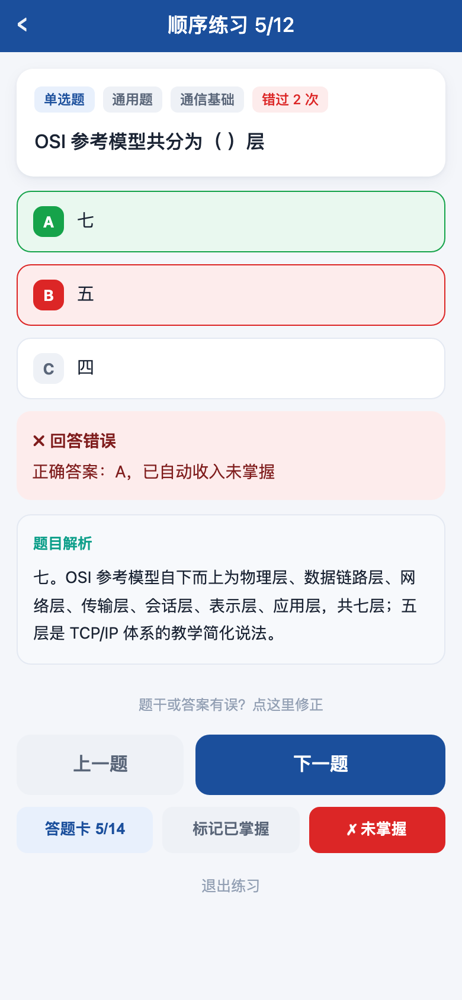 |
| **答题卡** | **成绩** | **未掌握** |
| 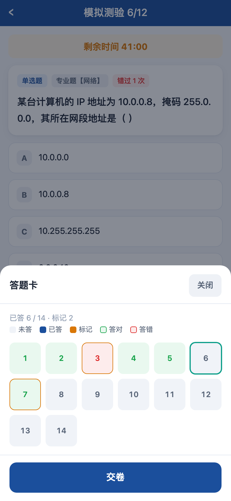 | 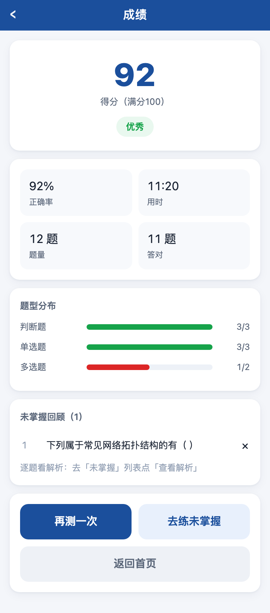 | 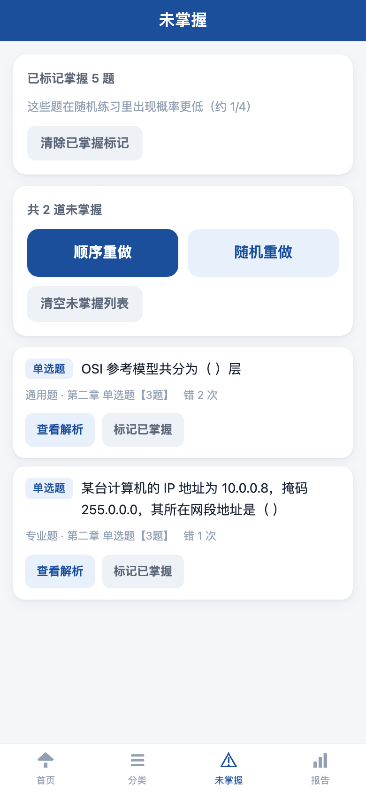 |
| **练习报告（概览）** | **练习报告（完整）** | **单题修改** |
| 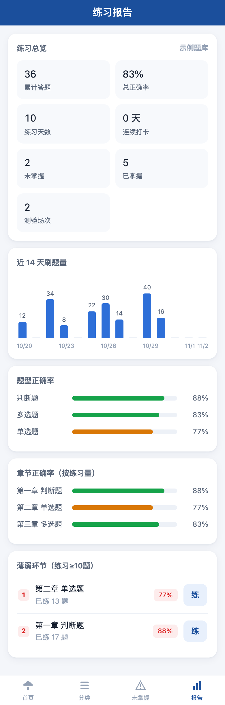 | 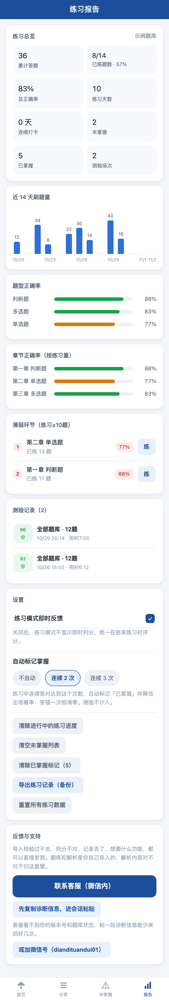 | 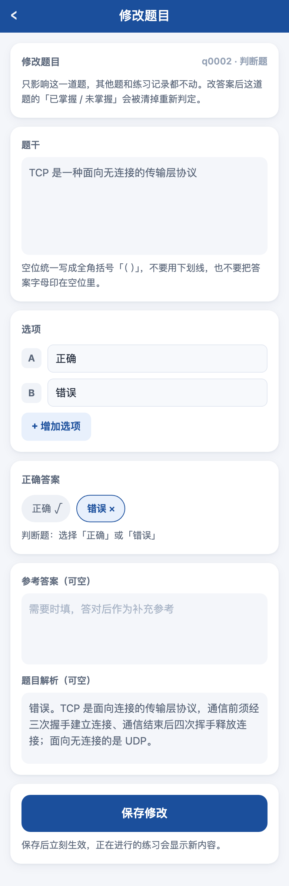 |

另有一套 **9 张统一尺寸**（780×1880，`docs/screenshots/share/`）用于九宫格发布：`node build/shots/render.js --share` 重新生成。长页面靠删次要卡片压进一屏（导航栏与 tabBar 保留），不缩放、不裁半行字。

---

## 掌握度与抽题

练习模式答完一题后，页面最底部（「答题卡」那一行的下面）给两个按钮：**标记已掌握** / **标记未掌握**。它们决定这道题以后多久再遇到你。

| 状态 | 怎么进 | 之后的表现 |
| --- | --- | --- |
| **未掌握** | 答错自动入库；或手动点「标记未掌握」 | 随机练习抽题权重 **×4**（最容易再遇到）；出现在「未掌握」页 |
| 普通 | 默认 | 权重 **×2** |
| **已掌握** | 练习中**连续答对 2 次自动标记**；或手动点「标记已掌握」 | 权重 **×1**（出现概率约为普通的 1/2、未掌握的 1/4） |

- **自动标记**的门槛在「报告 → 设置 → 自动标记掌握」里可调（连续 2 次 / 3 次 / 不自动）。只统计练习模式：测验答对不计入，因为测验不给即时反馈，自动标记会显得莫名其妙。
- 答错一次即清零连续计数，并立刻退出「已掌握」——同一道题不会同时出现在「已掌握」和「未掌握」两处。
- 手动点「标记未掌握」也会把连续计数清零，否则下一次答对立刻又被自动标成已掌握，按钮像没生效。
- **近期降温**：最近做过的题权重再乘 **0.25**，避免同一批题连着几轮反复出现。降温窗口按题池比例走——窗口宽度 = 当前题池的一半（池大池小都成立），队列最多记 500 道。池 200 题每轮抽 50 题，相邻两轮的重合从原来约 13 道降到约 5 道；5 轮里出现 4 次的题从 3.4 道降到 0.4 道。
- **随机练习**按上面的权重加权抽题（加权不放回，A-Res 算法，支持小数权重）；**模拟测验不加权**（保持公平抽样，成绩才有可比性）；顺序练习按题库原序，不涉及概率。
- 题量档位跟着题库规模走：固定档 20 / 50 / 100 题，池 ≥ 100 题时再补 10% / 25% 两档，最后是「全部」。3 千题的库抽 50 题连 2% 都不到，光靠固定档覆盖不过来。
- 主观题自评的「已掌握 / 未掌握」按钮与客观题是同一套状态。

报告页「练习总览」有两个互不推导的进度口径：**累计答题**是次数（同一道题练 5 次算 5），**已练题数**是去重覆盖（形如 `8/14`，分母是当前题库总题数，只统计真正作答过的题）。想知道「这套题库碰过多少」看后者。

## 改题目、改题库名

- 练习页判分后，解析下方有「题干或答案有误？点这里修正」→ 直接改题干、选项、答案、解析，也能在「未掌握」页的解析弹层里点「修改」。改完立刻生效，**不会影响练习记录**（题库指纹沿用旧值，所以不会被当成换题库）；这道题原有的已掌握/未掌握判定会清掉重新积累，历史答题次数保留。改坏了有「还原为修改前的版本」。
- 题库名在「导入题库 → 当前题库 → 改名」里设。导入文件时会默认用文件名，粘 JSON 导入则导入完成后弹一次让你取名。名字会出现在分类页顶部、首页标题栏和练习报告里。
- 已掌握标记可整体清除：报告页或「未掌握」页的「清除已掌握标记」。

---

## 只要题库 JSON？（不做小程序，最常用）

大部分人其实只想要一份能导入的标准 JSON。**不用装任何东西**，把下面这句丢给会读网页的 AI（元宝 / DeepSeek / 豆包 / ChatGPT 等），再把题库文档一起发过去：

> 读这个文件里的题库转换规范，然后严格按它把我的题库转成标准 JSON：
> https://raw.githubusercontent.com/xprears/shuati-miniprogram/main/skills/bank-json/SKILL.md
> 先打开链接读完规范再动手；只输出 JSON 数组，不要解释、不要代码块标记。

AI 会自己打开这份规范照着转，**不用你复制一万字提示词**。

支持技能安装的 Agent（WorkBuddy / Claude Code 等）可以直接装，装完一句「把我的题库转成标准 JSON」就够了：

**https://github.com/xprears/shuati-miniprogram/blob/main/skills/bank-json/SKILL.md**

> 手动安装：把 `skills/bank-json/` 整个目录复制到 `~/.workbuddy/skills/shuati-bank-json/`。

转完把 JSON 贴进小程序「导入题库」，或者存成 `.json` 发到微信聊天再从会话里选文件。

**两条硬规矩**（这两处错了导入必失败）：

- 根节点必须是**数组**，不能包成 `{"questions": [...]}`。
- 题干空位一律写全角 **`（ ）`**；原文把答案印在空位里（如「在（B）米及以上」）要换成「（ ）」，答案搬到 `answer`。

AI 打不开链接时（手机端不少 AI 读不了网页），退回用完整提示词：[docs/ai-bank-prompt.md](docs/ai-bank-prompt.md)。

---

## 快速开始（推荐）

**三步，不用敲命令、不用装 Python —— 让 WorkBuddy 干。**

### 1. 安装技能

把技能地址发给 WorkBuddy 让它安装：

**https://github.com/xprears/shuati-miniprogram/blob/main/skills/SKILL.md**

> 手动安装也一样简单：把仓库里的 `skills/SKILL.md` 复制到 `~/.workbuddy/skills/shuati-bao/` 即可。

### 2. 把题库文件交给 WorkBuddy

打开 WorkBuddy，说一句：

> 用刷题本子把这个题库做成小程序

然后把 PDF / Word / 文本拖进对话，或直接粘贴内容。

### 3. 扫码试用并发布

WorkBuddy 会自己完成：拉代码 → 文档转标准题库 JSON（+ 解析 JSON）→ 生成小程序 → 拉起预览。
点开预览卡片扫码，就能在真机上刷题。满意后点预览面板右上角 **「分享 / Share」→ 发布**。

---

## 技能做了什么

技能说明写在 [skills/SKILL.md](skills/SKILL.md)，你不用手敲，但知道流程便于排错：

```
你的文档（PDF / Word / 文本）
   │  ① 按提示词 A 转成 build/questions.json
   │  ② 有答案要点时按提示词 B 生成 build/explanations/ch1_analysis.json
   ▼
③ node build/build_bank.js   →  miniprogram/utils/qbank.js（预置题库，可选）
③' 空壳发布：跳过构建，直接发布（用户进 App 自行导入题库）
④ node build/mp-lint.js      →  静态校验（文件齐全 / 事件 / 体积）
④' node build/mp-lint.js --release  →  空壳发布检查（发布物不得含 qbank.js）
⑤ WorkBuddy 拉起 miniprogram/ 预览 → 扫码 → 发布
```

`build_bank.js` 与 `mp-lint.js` 都是**零依赖 Node 脚本**（WorkBuddy 自带 Node），会校验 id 重复、题型非法、选项键断号、答案越界，并报告解析覆盖了多少题。

### 想自己敲命令行

只在你想手动控制时用得上：

```bash
git clone --depth 1 https://github.com/xprears/shuati-miniprogram.git
cd shuati-miniprogram
node build/build_bank.js --sample    # 生成示例题库（开发预览/测试用，发布空壳版前删掉）
node build/build_bank.js             # 用自己的 build/questions.json（预置题库形态）
node build/mp-lint.js                # 校验
node build/mp-lint.js --release      # 空壳发布前必跑：确认发布物不含 qbank.js
```

**发布空壳版**：删掉 `miniprogram/utils/qbank.js`（或一开始就不生成），跑 `node build/mp-lint.js --release` 全绿即可。真机首次进入会显示空态与导入引导。

---

## 题库格式

AI 会按下面的格式产出 `build/questions.json`（一个**数组**，每个元素一道题）。想手改也照这个来：

```json
[
  {
    "id": "q0001",
    "type": "single",
    "stem": "下列设备中，工作在数据链路层的是（ ）",
    "options": [
      { "key": "A", "text": "交换机" },
      { "key": "B", "text": "路由器" },
      { "key": "C", "text": "中继器" },
      { "key": "D", "text": "集线器" }
    ],
    "answer": "A",
    "part": "一、通用题【各单位】",
    "chapter": "第二章 单选题【3题】",
    "category": "通信基础",
    "qno": 1
  }
]
```

| 字段 | 必填 | 说明 |
| --- | --- | --- |
| `id` | ✓ | 全局唯一，如 `q0001`。解析文件靠它对应 |
| `type` | ✓ | `judge` 判断 / `single` 单选 / `multi` 多选 / `blank` 填空 / `essay` 论述 / `scenario` 情景 / `case` 案例分析 / `operation` 实操模拟 |
| `stem` | ✓ | 题干。**空位统一写全角「（ ）」**（U+FF08 + 空格 + U+FF09） |
| `options` | 客观题 | `[{"key":"A","text":"…"}]`，键必须从 A 起连续；**选项数不固定**（3 项、5 项都支持） |
| `answer` | 客观题 | 判断题用 `√` / `×`；单选题一个字母；多选题 2 个以上字母（如 `ACD`） |
| `blanks` | 填空题 | 每空一项、顺序与题干「（ ）」一致，如 `["3×10^8|3e8", "9"]`。一个空多种写法用 `\|` 分隔，命中任一即算对 |
| `reference` | 主观题 | 参考要点原文，编号建议 `(1)(2)(3)` |
| `part` | ✓ | 大部，如 `一、通用题【各单位】`、`二、专业题【无线】` |
| `chapter` | ✓ | 章节，如 `第七章 单选题【120题】` |
| `category` | ✗ | 分类标签，可为 `null` |
| `qno` | ✗ | 原文题号（便于对照纸质卷） |
| `analysis` | ✗ | 题目解析，由解析文件注入，不必手写 |

构建产物 `miniprogram/utils/qbank.js` 的字段被压缩：`i`=id `t`=类型 `s`=题干 `p`=大部 `c`=章节 `g`=分类 `o`=选项 `a`=答案 `r`=参考答案 `x`=解析。
**它是产物，不要手改**（下次构建即被覆盖），也已被 `.gitignore` 排除。

### 自定义

- 题型标签、题池规则：`miniprogram/utils/logic.js`（`TYPE_LABEL` / `TYPE_ORDER` / `poolIds`）
- 配色与标题：`miniprogram/app.wxss`、`miniprogram/app.json`（`navigationBarTitleText` 与 `tabBar`）

#### 命名口径（改动前先看这里）

「刷题本子」是**产品名**（简称「刷题本」），「××题库」是**内容名**，两者分工固定，不要混用：

| 位置 | 写什么 | 改哪里 |
| --- | --- | --- |
| 导航栏标题 | 产品名全称（刷题本子） | `app.json` 的 `navigationBarTitleText`、`pages/index/index.json` |
| 分享文案 | 产品名全称（刷题本子） | 各页 `onShareAppMessage` 的 `title` |
| 首页 hero 大标题 | **工具定位**（固定「刷题练习工具」） | `pages/index/index.wxml` 的 `.hero-title` |
| 题库内容本身 | 题库名（题库全称，如「2026年全国应急通信技能比武理论考核题库」） | `build/questions.json`、PDF 原件 |

> **名称沿革（2026-10-16）**：由「刷题宝」更名为「刷题本子」——原名在微信侧已被他人占用。全称「刷题本子」、简称「刷题本」；代码、导航栏、分享文案一律用全称，简称只填 mp 后台的「小程序简称」字段。

> **hero 标题为什么是「刷题练习工具」而不是题库名**：产品按工具类小程序过审（见「上架定位」一节），题库名只在内容层出现，不上 UI。
> 题库名只有一个出处：题库原件（PDF/Word）的标题，改内容层时以原件为准，不要从产品名反推。

---

## 题目解析

解析单独存放，一个 id 对应一条讲解：

```
build/explanations/ch1_analysis.json   # 第一章
build/explanations/ch2_analysis.json   # 第二章
...
```

格式就是「题号 → 解析文本」的映射：

```json
{
  "q0001": "交换机工作在数据链路层。它依据 MAC 地址转发数据帧；路由器依据 IP 地址工作在网络层；中继器与集线器工作在物理层，只做信号再生与广播。"
}
```

文件名必须是 `ch<数字>_analysis.json`。解析注入后 App 里出现在：练习模式的答题反馈区、主观题「查看参考答案」区、自评页、未掌握页「查看解析」弹层。
**测验模式与「关闭即时反馈」时不显示解析**，避免泄题。

### 写作要求（直接影响 App 里的可读性）

- **客观题**：首句直接给结论，并把正确选项的核心文本并列写出来；干扰项只放在第一个句号之后。不要用「A 为…」这种字母开头。
- **判断题**：固定以「正确。」或「错误。」开头，再说理由。
- **多选题**：首句并列所有正确项；全对的题写明「本题各项均正确，无干扰项」。
- **主观题**：≥120 字，覆盖参考答案里的每个要点编号，不能只复述题干。
- **不要编造**：题干和选项之外的事实性宣称（数值、倍率、标准号）必须可追溯；追溯不到就写成「按本题库答案」的中性表述。
- **题库答案与常识冲突时**：以题库答案为准，在解析末尾用括号注明严格的学科定义，**不要**替题库编一套自相矛盾的机理。

---

## 提示词

想自己跟 AI 对话生成题库与解析，直接用现成提示词：

📄 **[docs/ai-bank-prompt.md](docs/ai-bank-prompt.md)** —— 提示词 A（文档 → 题库 JSON）、提示词 B（题库 → 解析 JSON），含字段规范、空位还原规则与「输入片段 → 正确输出」示例。

---

## 部署到微信小程序（通过 WorkBuddy）

小程序代码就在 `miniprogram/`，两种方式任选。

### ⚠️ 上架定位：工具类小程序（个人主体必读）

本产品按**工具类**定位设计与过审，**不要**改成教育培训类：

- **个人主体选不了「教育」类目**。微信官方口径：教育 / 医疗 / 金融 / 新闻 / 电商等类目个人主体一律禁入，硬走「考核题库」定位无法备案、无法过审。
- 服务类目选 **「工具 → 信息查询」**——个人主体的安全区，也是刷题工具类小程序的实战过审类目。
- 备案时服务内容勾选「工具」；小程序名称、简介、UI 文案均不得出现「考试 / 培训 / 考核 / 授课 / 备考」等教育属性话术。仓库代码已按此口径做过文案去敏（"考试"统一为"测验"、首页标题为"刷题练习工具"），二次开发时**别把敏词加回去**。
- 题库内容是工具的内置数据（自测练习用），对外口径统一为「刷题练习工具」，不是教学服务。
- 个人主体备案材料：本人身份证、实名登记的手机号、精确到门牌号的地址、管理员人脸核验。**备案通过后才能提交审核**（2023-09 起强制，周期约 1-3 周）。

### 空壳发布（默认形态）提交前必做

默认发布形态是**空壳**：小程序不含任何题库，终端用户在 App 内粘贴 JSON 或从聊天会话选文件自行导入。以下三项在代码里看不出来，但漏了会出问题：

1. **⚠️ 必须在 mp 后台配《用户隐私保护指引》，否则选文件功能静默失败**
   路径：mp 后台 → 设置 → 基本设置 → 服务内容声明 → 用户隐私保护指引。勾选**两项**，用途说明照抄 [`miniprogram/.wbapp_FG9QvWu6UsK9q5itCbHFFF.privacy.json`](miniprogram/.wbapp_FG9QvWu6UsK9q5itCbHFFF.privacy.json)：

   | 接口 | 对应功能 | 用途说明 |
   | --- | --- | --- |
   | `Clipboard` | 复制题库模板 / 解析提示词 / 导出题库与练习记录备份 | 复制题库模板、解析提示词、题库 JSON 与练习记录备份，并在导入时读取剪贴板内容 |
   | `MessageFile` | `wx.chooseMessageFile` 选题库文件 | 读取你从微信聊天会话中选择的题库文件，仅在本机解析，不会上传服务器 |

   不配的后果：`wx.chooseMessageFile` 在真机上点了没反应（无报错、无回调）。改动隐私指引需重新提交审核，1-3 个工作日。
   **不要多声明**：本 App 不收集用户发布内容，所以不勾 `EXUserPublishContent`（分享自己的页面不算）——多声明一项就多一条要向审核解释的主张。声明与实际调用必须一一对应，调了不声明会被驳回、没调却声明会被要求移除。
2. **发布前跑发布检查**：`node build/mp-lint.js --release` 必须 0 失败。它会检查发布物不含内置题库、且所有字面量 `require` 的目标都在发布包内——`project.config.json` 的 `packOptions.ignore` 已排除 `utils/qbank.js`，所以本地开发副本可以保留题库文件供 Node 测试用（由测试脚本经 `bankStore.__setNodeBank` 注入，`bank-store.js` 自身不 require 它），上传时自动不带。

> 预置题库形态是**可选**的：想让小程序自带题库，把 `build/questions.json` 放进 `build/` 跑 `node build/build_bank.js` 生成 `qbank.js`，并从 `packOptions.ignore` 里删掉那行——但记得先跑一次 `--release` 确认这是你要的形态。

### 方式 A：WorkBuddy 预览 + 发布（推荐，不用装开发者工具）

1. 在 WorkBuddy 里打开本项目目录，说「**预览小程序**」——它会识别 `miniprogram/` 并生成**小程序产物卡片**。
2. 点开卡片进入预览，用微信扫码即可在真机上试。
3. 预览面板右上角 **「分享 / Share」→ 发布**：
   - 选「**试用小程序**」：几分钟出一个可长期使用的体验版，够内部小范围使用；
   - 或「**绑定已有小程序**」：填自己的 AppID，发到自己的正式小程序。
4. 发布时填你自己的 AppID 即可（产品零后端，换 ID 没有任何额外约束）。

> ⚠️ 小程序的「部署」只是把代码登记到应用名下，**不出分享链接**；上传与提审要在预览面板「分享 → 发布」里完成。

### 方式 B：微信开发者工具

用微信开发者工具「导入项目」，目录选 `miniprogram/`；把 `project.config.json` 里的 `appid` 换成你自己的 AppID（不换则用测试号，只能本机预览）。

### 关于后端

本产品**不连接任何服务器**：题库、答题记录、未掌握清单、已掌握标记全部存在用户手机本地，也没有账号系统。想加云同步 / 题库分享 / 结构化反馈收集时再上后端，按当前定位不需要。

**反馈走微信客服，不需要服务器**：报告页底部「反馈与支持」里有一个 `open-type="contact"` 按钮，用户点一下直接进小程序客服会话，消息落在微信的客服系统里，用 mp 后台「客服」页或手机「小程序客服」处理。

- 启用前提：mp 后台 → 功能 → 客服 → 客服人员，加一个客服微信号。**没加之前按钮点了静默无反应**（无 fail 回调），所以先配好再把 `miniprogram/utils/contact.js` 里的 `CONTACT.useCustomerService` 置 `true`。
- 客服会话**只透传聊天内容、不带任何上下文**，所以旁边配了「先复制诊断信息」：一键把版本号、题库名与指纹、累计答题/正确率/未掌握/已掌握/测验场次、上次测验、所在页面拼成一段文本，用户粘进会话即可。导入页的报错态也有同样的一对按钮（复制报错 + 联系客服）。
- `contact.js` 是唯一配置点；客服关闭且微信号/邮箱都为空时，整块反馈卡不渲染（线上不会出现空按钮）。
- 想要**可导出、可统计、按题号批量看**的反馈，那就必须有服务端——微信客服只能按会话人工看。

---

## 目录结构

```
.
├─ miniprogram/                    微信小程序
│  ├─ app.js / app.json / app.wxss
│  ├─ pages/                       首页 · 导入题库 · 分类 · 未掌握 · 报告 · 设置 · 练习 · 结果 · 单题修改
│  ├─ utils/logic.js               纯逻辑：评分 / 题池 / 结构树（reload 支持换题库）
│  ├─ utils/store.js               本地进度、未掌握清单、已掌握标记与自动掌握计数
│  ├─ utils/bank-store.js          题库运行期存储（storage 分片，单 key ≤1MB；索引已按多题库布局预留）
│  ├─ utils/bank-validate.js       题库规范化/校验（含单题校验）/压缩（Node 与小程序双端复用）
│  ├─ utils/confirm.js             破坏性操作的两跳确认（清空未掌握 / 清除题库 / 全部重置）
│  ├─ utils/qbank.js               ← 预置题库构建产物（不入库；空壳发布不含此文件）
├─ build/
│  ├─ build_bank.js            ★   构建：questions.json → miniprogram/utils/qbank.js（零依赖）
│  ├─ mp-lint.js                   小程序静态校验（体积 / 事件 / API 白名单 / --release 空壳检查）
│  └─ sample/                      示例题库 + 示例解析
├─ docs/
│  ├─ ai-bank-prompt.md            AI 生成题库 / 解析的提示词
│  ├─ 用户题库导入方案.md           空壳发布（用户自行导入）的设计与实施记录
│  └─ screenshots/                 界面截图
└─ skills/SKILL.md                 WorkBuddy 技能（导入即用，见「快速开始」）
```

---

## 常见问题

**为什么仓库里没有 `miniprogram/utils/qbank.js`？**
它是构建产物，内容就是你的题库。`.gitignore` 已排除，避免把题库误传上 GitHub。跑一次 `node build/build_bank.js --sample`（或让技能生成）就有了。**空壳发布形态下这个文件本就不该存在**，`node build/mp-lint.js --release` 会检查这一点。

**必须装 Python 吗？**
不用。`build_bank.js` / `mp-lint.js` / 两个测试脚本都是零依赖 Node 脚本 —— WorkBuddy 自带 Node 就能跑。

**用户怎么把题库上传进小程序？**
打开小程序 → 首页（无题库时）点「导入题库」，或分类页顶部的「题库管理」→ 粘贴 JSON / 从微信聊天选文件 → 校验通过后启用。详细引导内置在导入页，用户不需要看任何外部文档。

**「从聊天记录选文件」点不了？**
该接口只能从微信聊天会话（单聊 / 群聊 / 文件传输助手）里选文件，且需从小程序卡片进入小程序。不在会话场景时按钮会提示改用粘贴。发布前记得在公众平台「用户隐私保护指引」声明「从聊天会话中选择文件」。

**主包会不会超 2MB？**
微信小程序主包上限 2MB。预置题库形态下，题库 + 解析全部编译进 `miniprogram/utils/qbank.js`，题目多、解析长时容易逼近上限（数千题 + 全量解析可接近 1.7MB）；空壳形态没有这个压力（题库在用户手机本地），接近上限时把 `qbank.js` 挪进分包，或让解析按需从云端拉。`node build/mp-lint.js` 会直接报主包与各分包体积。

**改了题库怎么生效？**
预置形态：改 `build/questions.json` 后重跑 `node build/build_bank.js`，开发者工具里刷新即可。空壳形态：用户在 App 内重新导入，即时生效。

**解析没显示？**
检查解析文件的键是否等于题库里的 `id`，以及构建时「解析：命中 N/M 题」的输出。测验模式和「关闭即时反馈」不显示解析，这是刻意设计。

**能换成别的内容吗？**
可以。这套东西本质是「题库 JSON → 刷题小程序」，把 `type`/`part`/`chapter` 换成你的学科结构即可；`miniprogram/utils/logic.js` 里改题型标签就能适配。

---

## 许可

示例代码可自由使用、修改、分发。**题库与解析内容不在本仓库内**，版权与使用范围请自行确认。需要正式开源许可可自行添加 `LICENSE`。
