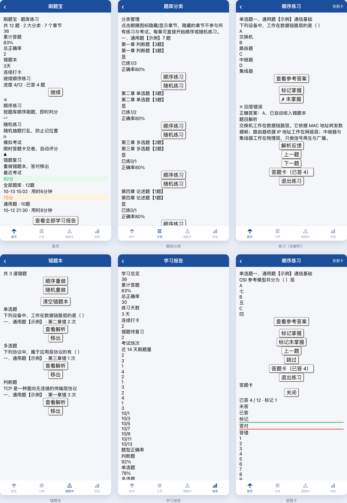

# 刷题宝 · 题库练习小程序

一份题库 JSON，编译成可以直接发布的**微信小程序**刷题应用。

功能：顺序 / 随机练习、模拟考试、错题本、答题卡、学习报告、主观题自评、题目解析、解析反馈（云端汇总）。



> **本仓库不含真实题库与解析**，只带 12 道示例题（覆盖全部 7 种题型）用于跑通流程。
> 请自备题库 —— 格式见 [题库格式](#题库格式)，生产流程见 [从 PDF / Word 生成题库](#从-pdf--word-生成题库)。

## 界面

| 首页 | 题库分类 | 练习（答错即时反馈 + 解析） |
| --- | --- | --- |
|  |  |  |
| **错题本** | **学习报告** | **答题卡** |
|  |  |  |

---

## 快速开始

```bash
# 1) 用示例题库构建（生成 miniprogram/utils/qbank.js）
python3 build/build_bank.py --sample

# 2) 用 WorkBuddy 预览并发布小程序 —— 见「部署到微信小程序」
```

换成自己的题库：把题库放到 `build/questions.json`、解析放到 `build/explanations/`，跑同一条命令（不带 `--sample`）：

```bash
python3 build/build_bank.py
```

---

## 目录结构

```
.
├─ miniprogram/                微信小程序
│  ├─ app.js / app.json / app.wxss
│  ├─ pages/                   首页 · 分类 · 错题本 · 报告 · 设置 · 练习 · 结果
│  ├─ utils/logic.js           纯逻辑：评分 / 题池 / 结构树（无 wx 依赖，可 Node 单测）
│  ├─ utils/store.js           本地进度与错题存储
│  ├─ utils/qbank.js           ← 构建产物（不入库，跑构建脚本生成）
│  └─ pkg-feedback/            解析反馈分包（提交表单 + 汇总列表 + 云 SDK）
├─ build/
│  ├─ extract_text.py          PDF / Word / 文本 → 纯文本
│  ├─ extract_pdf.py           同上，只处理 PDF（旧脚本，保留兼容）
│  ├─ parse_bank.py            纯文本 → questions.json
│  ├─ bank_export.py           压缩与导出的唯一实现
│  ├─ build_bank.py            ★ 一键构建：questions.json → miniprogram/utils/qbank.js
│  ├─ merge_analysis.py        只合并解析、不重跑 PDF
│  ├─ mp-lint.js               小程序静态校验（体积 / 事件 / API 白名单）
│  └─ sample/                  示例题库 + 示例解析
└─ docs/
   ├─ ai-bank-prompt.md        用 AI 生成题库 JSON 的提示词
   └─ screenshots/             README 用的界面截图
```

---

## 题库格式

`build/questions.json` 是一个**数组**，每个元素是一道题：

```json
[
  {
    "id": "q0001",
    "type": "single",
    "stem": "下列设备中，工作在数据链路层的是（ ）",
    "options": [
      { "key": "A", "text": "交换机" },
      { "key": "B", "text": "路由器" },
      { "key": "C", "text": "中继器" },
      { "key": "D", "text": "集线器" }
    ],
    "answer": "A",
    "part": "一、通用题【各单位】",
    "chapter": "第二章 单选题【3题】",
    "category": "通信基础",
    "qno": 1
  }
]
```

| 字段 | 必填 | 说明 |
| --- | --- | --- |
| `id` | ✓ | 全局唯一，如 `q0001`。解析文件靠它对应 |
| `type` | ✓ | `judge` 判断 / `single` 单选 / `multi` 多选 / `essay` 论述 / `scenario` 情景判断 / `case` 案例分析 / `operation` 实操模拟 |
| `stem` | ✓ | 题干。**空位统一写全角「（ ）」**（U+FF08 + 空格 + U+FF09） |
| `options` | 客观题 | `[{"key":"A","text":"…"}]`，键必须从 A 起连续；**选项数不固定**（3 项、5 项都支持） |
| `answer` | 客观题 | 判断题用 `√` / `×`；单选题一个字母；多选题 2 个以上字母（如 `ACD`） |
| `reference` | 主观题 | 参考要点原文，编号建议 `(1)(2)(3)` |
| `part` | ✓ | 大部，如 `一、通用题【各单位】`、`二、专业题【无线】` |
| `chapter` | ✓ | 章节，如 `第七章 单选题【120题】` |
| `category` | ✗ | 分类标签，可为 `null` |
| `qno` | ✗ | 原文题号（便于对照纸质卷） |
| `analysis` | ✗ | 题目解析，一般由解析文件注入，不必手写 |

`build/build_bank.py` 会做一遍格式校验（id 重复、题型非法、选项键不连续、答案越界等），有问题会打印出来但不中断构建。

### 构建产物

```
miniprogram/utils/qbank.js   →   module.exports = [...]
```

字段被压缩：`i`=id `t`=类型 `s`=题干 `p`=大部 `c`=章节 `g`=分类 `o`=选项 `a`=答案 `r`=参考答案 `x`=解析。
**这个文件是产物，不要手改**（下次构建即被覆盖），也已被 `.gitignore` 排除。

### 自定义

- 题型标签、题池规则：`miniprogram/utils/logic.js`（`TYPE_LABEL` / `TYPE_ORDER` / `poolIds`）
- 配色与标题：`miniprogram/app.wxss`、`miniprogram/app.json`（`navigationBarTitleText` 与 `tabBar`）

---

## 题目解析

解析**单独存放**，一个 id 对应一条讲解，与题库解耦：

```
build/explanations/ch1_analysis.json   # 第一章
build/explanations/ch2_analysis.json   # 第二章
...
```

格式就是「题号 → 解析文本」的映射：

```json
{
  "q0001": "交换机工作在数据链路层。它依据 MAC 地址转发数据帧；路由器依据 IP 地址工作在网络层；中继器与集线器工作在物理层，只做信号再生与广播。"
}
```

文件名必须是 `ch<数字>_analysis.json`（`build/bank_export.py` 按此规则收集）。解析会被注入题库的 `x` 字段，App 里出现在：

- 练习模式的答题反馈区（客观题答完后即时显示）
- 主观题「查看参考答案」区
- 自评页
- 错题本「查看解析」弹层

考试模式与「关闭即时反馈」时**不显示解析**，避免泄题。

### 写作要求（直接影响 App 里的可读性）

- **客观题**：首句直接给结论，并把正确选项的核心文本并列写出来；干扰项只放在第一个句号之后。不要用「A 为…」这种字母开头。
- **判断题**：固定以「正确。」或「错误。」开头，再说理由。
- **多选题**：首句并列所有正确项；全对的题写明「本题各项均正确，无干扰项」。
- **主观题**：≥120 字，覆盖参考答案里的每个要点编号，不能只复述题干。
- **不要编造**：题干和选项之外的事实性宣称（数值、倍率、标准号）必须可追溯；追溯不到就写成「按本题库答案」的中性表述。
- **题库答案与常识冲突时**：以题库答案为准，在解析末尾用括号注明严格的学科定义，**不要**替题库编一套自相矛盾的机理。

> 解析很多时建议按章分片生产，写完后自查：解析首句是否与正确项一致、否定型题干（「不属于」「错误的是」）的解析是否给出明确否定、解析是否过短、不同题是否有逐字重复。

---

## 从 PDF / Word 生成题库

```bash
# 0) 依赖（只处理 PDF 时需要）
pip install pdfplumber

# 1) 原文 → 纯文本（支持 .pdf / .docx / .txt；自动找项目根目录下的文件）
python3 build/extract_text.py
#   → build/raw_text.txt

# 2) 纯文本 → questions.json（识别「一、/第N章 题型【N题】/第N类/1、题干（答案）A. …」结构）
python3 build/parse_bank.py
#   → build/questions.json

# 3) 注入解析 → 小程序产物
python3 build/build_bank.py
```

- **Word 支持**：`.docx` 用标准库解析（无需额外依赖），段落与表格都会提取；`.doc` 旧格式请先在 Word 里另存为 `.docx`。
- **排版兜底**：原文偶有排版坏题（空位判定失灵、残题被丢弃）。把人工兜底写进 `build/bank_overrides.py`（模板见 `build/bank_overrides.example.py`），三项配置分别处理「题干末尾补空位」「空位插回句中」「残题按锚点补录」。改完重跑 `parse_bank.py`。
- 只更新解析、不想重跑原文时：`python3 build/merge_analysis.py`

> 提示：自动解析不可能 100% 准确。跑完 `parse_bank.py` 请检查打印的「丢弃 / 异常合计 / 选项数分布」，人工抽查几十题再定稿。

---

## 用 AI 生成题库 JSON

不想写解析脚本？把原文丢给大模型，用现成提示词产出 `questions.json` 与解析文件：

📄 **[docs/ai-bank-prompt.md](docs/ai-bank-prompt.md)** —— 两段可直接复制的提示词（A：原文 → 题库 JSON；B：题库 → 解析），以及输入输出示例。

---

## 部署到微信小程序（通过 WorkBuddy）

小程序代码就在 `miniprogram/`，两种方式任选。

### 方式 A：WorkBuddy 预览 + 发布（推荐，不用装开发者工具）

1. 在 WorkBuddy 里打开本项目目录，对助手说「**预览小程序**」（或「打开小程序预览」）。
   WorkBuddy 会识别 `miniprogram/` 并生成**小程序产物卡片**。
2. 点开卡片进入预览，用微信扫码即可在真机上试。
3. 预览面板右上角 **「分享 / Share」→ 发布**：
   - 选「**试用小程序**」：几分钟出一个可长期使用的体验版，够内部小范围使用；
   - 或「**绑定已有小程序**」：填自己的 AppID，发到自己的正式小程序。
4. 发布时**保持同一个应用 ID**（若你开通过云服务，换 ID 会导致云服务校验失败）。

> ⚠️ 小程序**不要**用 `sites` 类的一键部署（部署预检会拒绝小程序目录），走上面的产物卡片即可。

### 方式 B：微信开发者工具

用微信开发者工具「导入项目」，目录选 `miniprogram/`；把 `project.config.json` 里的 `appid` 换成你自己的 AppID（不换则用测试号，只能本机预览）。

### 解析反馈（可选）

`miniprogram/pkg-feedback/` 会把「解析有问题」的反馈汇总到云端，题主在首页长按标题进入汇总页。启用步骤：

1. 在 WorkBuddy 里为本项目开通云服务，建一张表（字段见 `pkg-feedback/lib/cloud.js` 里的 `row`：`question_id / qno / chapter / part / qtype / stem / kind / content / client_tag / created_at`）。
2. 行级权限：给 `anon`、`authenticated` 开 **SELECT** 与 **INSERT** 即可（刻意不开 UPDATE / DELETE —— 小程序端删不掉数据，客户端反编译也没有破坏风险；清理由题主在后台按需删除）。
3. 复制 `miniprogram/pkg-feedback/lib/config.example.js` 为 `config.js`，把激活返回的 `endpoint`、`publishableKey` 填进去：

```js
module.exports = {
  endpoint: 'https://mp-api.app.workbuddy.host',
  publishableKey: 'wbpk_你的appId_xxxxxxxx',
  table: 'question_feedback'
};
```

`config.js` 已被 `.gitignore` 排除（属于你自己的凭据，不要提交）。**不配也能跑**：反馈入口会提示「云服务未配置」，刷题、错题本、报告等功能完全不受影响。

---

## 常见问题

**主包会不会超 2MB？**
微信小程序主包上限 2MB。题库 + 解析全部编译进 `miniprogram/utils/qbank.js`，题目多、解析长时容易逼近上限（数千题 + 全量解析可接近 1.7MB）。接近上限时把 `qbank.js` 挪进分包，或让解析按需从云端拉。`node build/mp-lint.js` 会直接报主包与各分包体积。

**为什么仓库里没有 `miniprogram/utils/qbank.js`？**
它是构建产物，内容就是你的题库。`.gitignore` 已排除，避免把题库误传上 GitHub。clone 后跑一次 `python3 build/build_bank.py --sample` 或带上自己的题库即可生成。

**改了题库怎么生效？**
`python3 build/build_bank.py` 重跑即可；小程序端在开发者工具里刷新即可看到。

**解析没显示？**
检查 id 是否对得上（解析文件的键必须等于题库里的 `id`），以及构建时「解析：命中 N/M 题」的输出。考试模式和「关闭即时反馈」不显示解析，这是刻意设计。

**能换成别的内容吗？**
可以。这套东西本质是「题库 JSON → 刷题小程序」，把 `type`/`part`/`chapter` 换成你的学科结构即可；`miniprogram/utils/logic.js` 里改题型标签就能适配。

---

## 许可

示例代码可自由使用、修改、分发。**题库与解析内容不在本仓库内**，版权与使用范围请自行确认。需要正式开源许可可自行添加 `LICENSE`。
